<div align="center">

# Think Aloud

**A voice mock interview that grades how you think, not just what you type.**

Talk through a coding problem with an AI interviewer, then replay the whole
session and see every moment that helped or hurt, underlined in your own words.

Free · open source · no backend · your key stays in your browser

[Quick start](#quick-start) ·
[Features](#features) ·
[What it costs](#what-a-session-costs) ·
[Privacy](#privacy) ·
[How it works](#how-it-works) ·
[Contributing](CONTRIBUTING.md)

<br>

<picture>
  <source media="(prefers-color-scheme: dark)" srcset="docs/screenshots/interview-dark.png">
  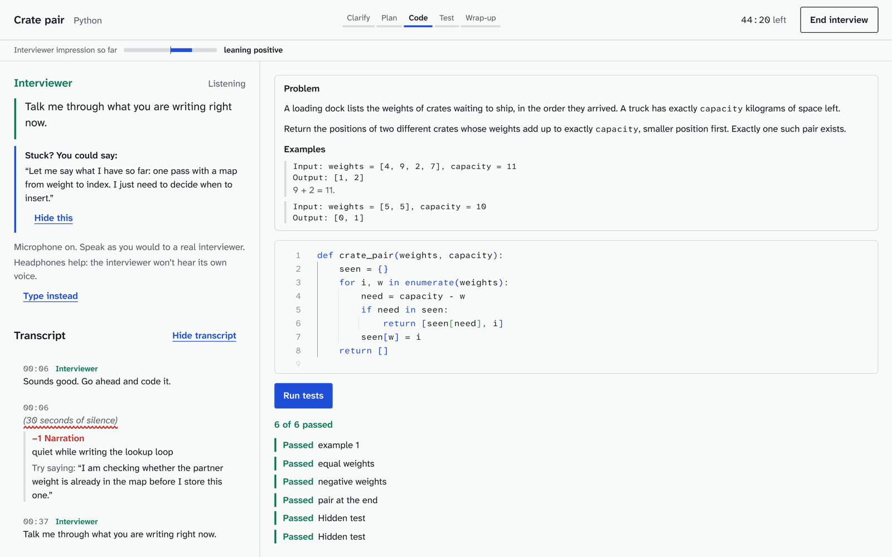
</picture>

</div>

## Why

Coding interviews quietly score your **process**: did you ask clarifying
questions, plan before typing, say why you chose a data structure, test your
own code, take a hint well? Most practice tools only check whether the code
passes. You can solve every problem on a practice site and still lose the
interview by coding in silence.

Think Aloud practices the part those sites can't see. You speak, an
interviewer listens and answers back, and afterwards you get a replay that
points at the exact second you went quiet, guessed, or explained something
well, with what a stronger candidate might have said instead.

## Features

### The marked-up transcript

Feedback is marker on your own words. Each note underlines the exact phrase
it's about and hangs in the margin beside it, with a timestamp. Strong
moments get a solid blue stroke, weak ones a red zigzag, missed
opportunities a dashed gray line, so the meaning never depends on color
alone.

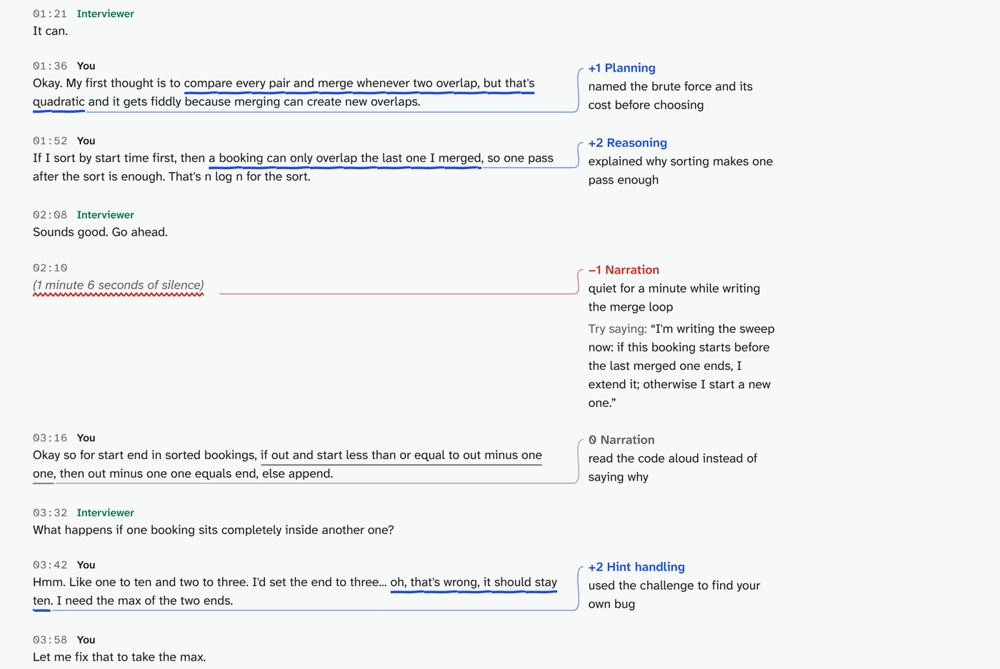

### A live interviewer that actually listens

- **Speaks and listens.** The interviewer talks out loud and hears you
  through your microphone. Interrupt it and it stops talking.
- **Knows when to speak.** Code, not the model, decides *when* to reply:
  after you finish a thought, after 30 seconds of silence with no code
  change, after a test run, at a phase change or a time mark. What it says
  is always the model's own words.
- **Three personas.** Friendly, Neutral, or Stone-faced.
- **A shared editor.** Python or JavaScript in a full Monaco editor, run
  in your browser against real tests, including hidden ones.
- **"Stuck? You could say".** In Training mode, when you stall, it offers
  one sentence you could say out loud to get moving again.
- **An impression meter** shows how the interviewer reads you so far.

### Three feedback modes

| Mode | When you see feedback |
|---|---|
| **Training** | Live, in the margin, as you talk |
| **Delayed** | At the end of each phase: clarify, plan, code, test, wrap-up |
| **Realistic** | Only in the replay, like a real interview |

### The replay

A timeline of the whole session, split into phases. Blue arrows mark strong
moments, red zigzags weak ones, dotted lines the things you didn't mention,
gray blocks your silences. Click any mark and the editor jumps to your code
at that second, the transcript scrolls to your words, and the recording
plays from there.

<picture>
  <source media="(prefers-color-scheme: dark)" srcset="docs/screenshots/replay-dark.png">
  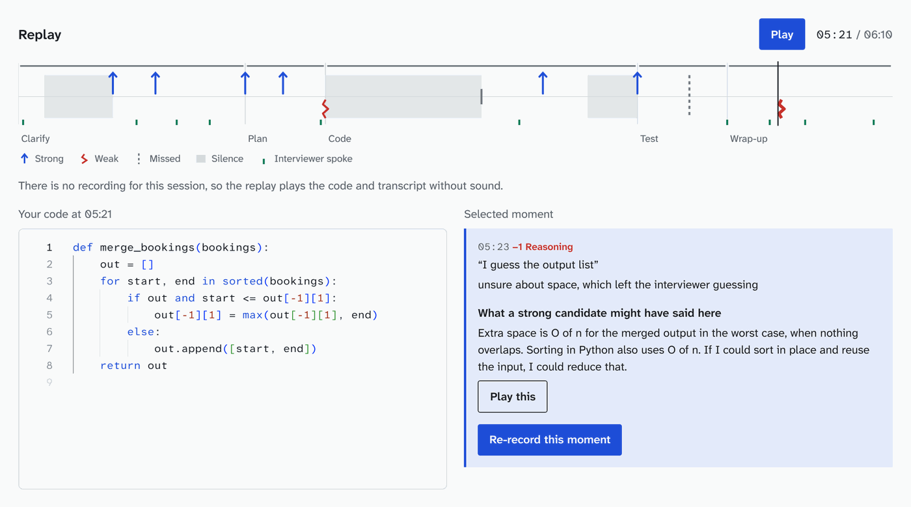
</picture>

- **What a strong candidate might have said.** Every weak moment comes with
  a better version you can read or hear.
- **Re-record this moment.** Say it again in your own words and get that
  moment rescored.
- **The walkthrough.** Every built-in problem includes a full example of
  thinking aloud, from first questions to wrap-up.

### Scores you can check

Six rubric categories, each scored 1 to 4, plus correctness from your real
test results and an overall signal. Every score quotes what you said, with a
timestamp.

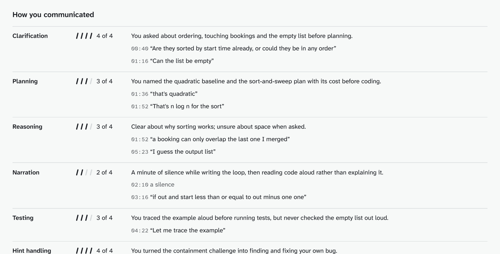

The scoring is built to be trusted:

1. **Code computes what code can count.** Talk-to-silence ratio, longest
   pause, whether you spoke before typing, time per phase. The model gets
   these as facts; it's never asked to count or time anything.
2. **Every quote is checked.** Code looks up each quoted phrase in your
   transcript. A score whose evidence can't be found gets one repair
   attempt, then is dropped.
3. **A second, independent pass reviews it.** A verification call reads
   each judgment against its evidence and can only lower or remove it,
   never raise it.
4. **The accurate transcript wins.** If a more accurate transcript was made
   from your recording after the interview, scoring uses it, and live
   notes are re-checked against it first.

### Progress over time

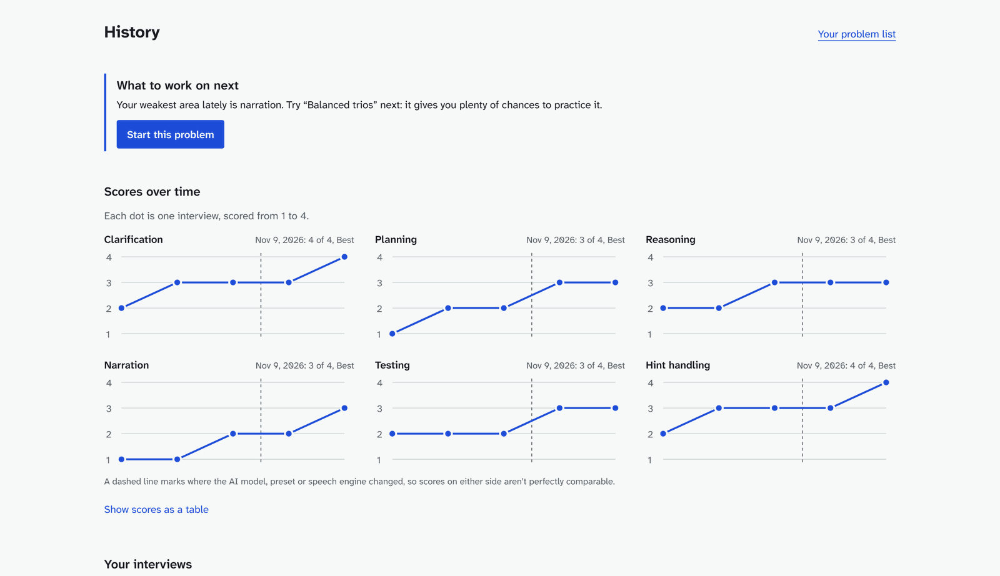

- One trend line per rubric category. A dashed line marks where you changed
  model, preset or speech engine, so you know scores on either side aren't
  perfectly comparable.
- **What to work on next** picks your weakest area and a problem that
  exercises it.
- Spend for the week and month, with an optional monthly limit.

### Problems

- **33 original problems** in the built-in bank (10 Easy, 22 Medium, 1
  Hard) across arrays and hashing, two pointers, sliding windows, stacks,
  linked lists, intervals, trees, graphs, heaps, binary search,
  backtracking and dynamic programming. Every one is written
  for this project, with its own scenario and tests, and comes with a
  precomputed analysis: clarifying questions, edge cases, approaches, a hint
  ladder, reference solutions in both languages, and the walkthrough.
- **Paste any problem.** It's analyzed once, its tests are checked against a
  generated reference solution, and the result is cached on your device.
- **Your problem list.** Keep links to problems you want to practice. It
  sorts them so the ones you scored lowest on come up first.
- **Variations.** Get a fresh twist on a problem you've already done.

### Your keys, your choice of models

- **Bring your own key**: Anthropic (default), OpenAI, Google Gemini, or any
  OpenAI-compatible endpoint (OpenRouter, Ollama, LM Studio).
- **Quality presets**: Economy, Balanced and Best, or pick each model
  yourself.
- **Or use your Claude subscription** through Claude Code on your own
  computer, with no API key. See [below](#use-your-claude-subscription-instead-of-a-key).
- **A live cost estimate** on the setup screen, and the **actual cost** after
  every session, computed from the usage the API reported, cached tokens
  included.

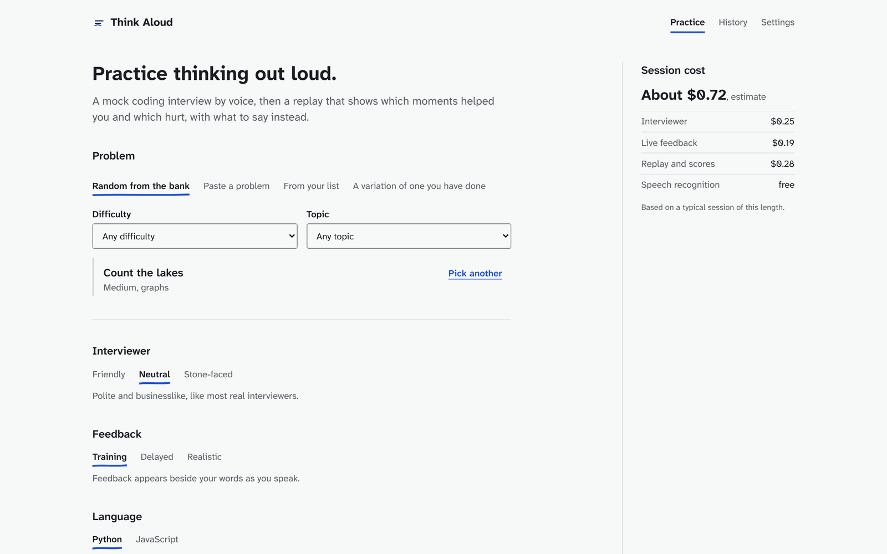

### Speech your way

| Engine | Live | After the interview | Where your audio goes |
|---|---|---|---|
| Browser speech (default) | Yes | | Your browser's speech service |
| On-device Whisper | | Yes | Nowhere. It runs on your computer |
| Deepgram | Yes | Yes | Deepgram, with your key |
| AssemblyAI | | Yes | AssemblyAI, with your key |
| OpenAI | | Yes | OpenAI, with your key |
| Typing | | | No audio at all |

The problem's own vocabulary is passed as keyword hints, so `heapq` and
`memoize` come through as words, not noise.

### Also

- **A dark theme** designed on its own: a slate chalkboard where all three
  marker colors keep their meaning.
- **Works on a phone.** One column, with margin notes moving under the line
  they're about.
- **A share card**: an image of your scores and overall signal, made on your
  device, with no name, transcript or code.
- **Export and import** everything (never keys), or delete it all.
- **A demo session** you can open without a key.

<table>
  <tr>
    <td width="33%">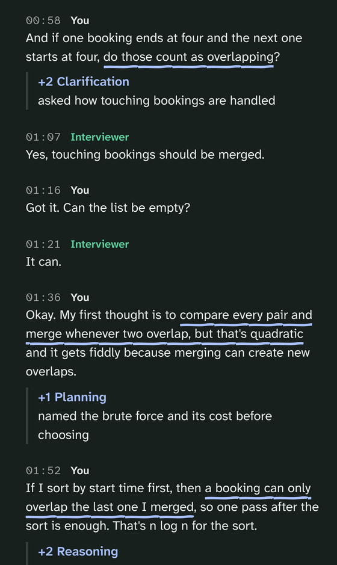</td>
    <td width="33%">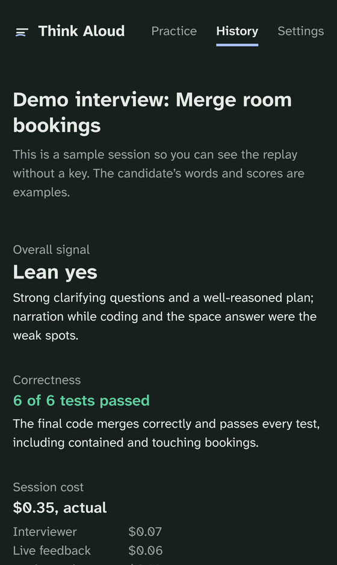</td>
    <td width="33%">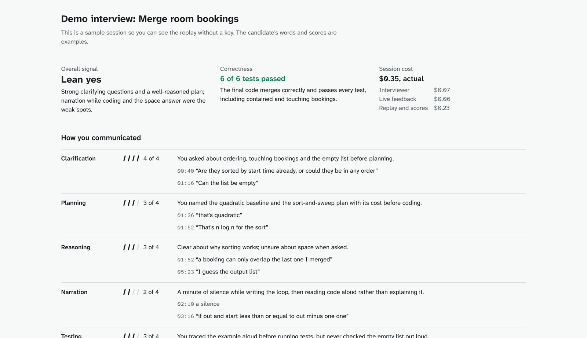</td>
  </tr>
</table>

## Quick start

```bash
git clone https://github.com/piyush-v-patil/think-aloud.git
cd think-aloud
npm install        # also copies Pyodide and ONNX Runtime into public/vendor
npm run dev        # http://localhost:5173
```

Open the app and watch the **demo session** (no key needed). Then add a key
in **Settings** and start an interview. Headphones help: the interviewer
won't hear its own voice.

### Getting an AI key

1. Create an account with a provider. Anthropic is the default:
   <https://platform.claude.com/settings/keys>.
2. Add a little credit. $5 covers many sessions.
3. Paste the key in **Settings** and choose whether to remember it on this
   device or for this session only. **Save and check key** sends one tiny
   request to confirm it works and has credit.

### Use your Claude subscription instead of a key

If you have [Claude Code](https://code.claude.com/docs/en/setup) installed
and signed in, Think Aloud can use it instead of an API key. Usage counts
against your Claude plan's limits. This is meant for your own practice with
your own account.

```bash
npm run claude-bridge
```

That starts a small bridge on `http://localhost:8787` and prints a bridge
token. In **Settings → AI provider**, choose **Claude Code**, paste the
token, and press **Save and check key**. Keep the terminal open while you
practice. Running the app with `npm run dev` is the most reliable way. Your
GitHub Pages site can reach the bridge too, though your browser may ask for
permission to connect to devices on your local network.

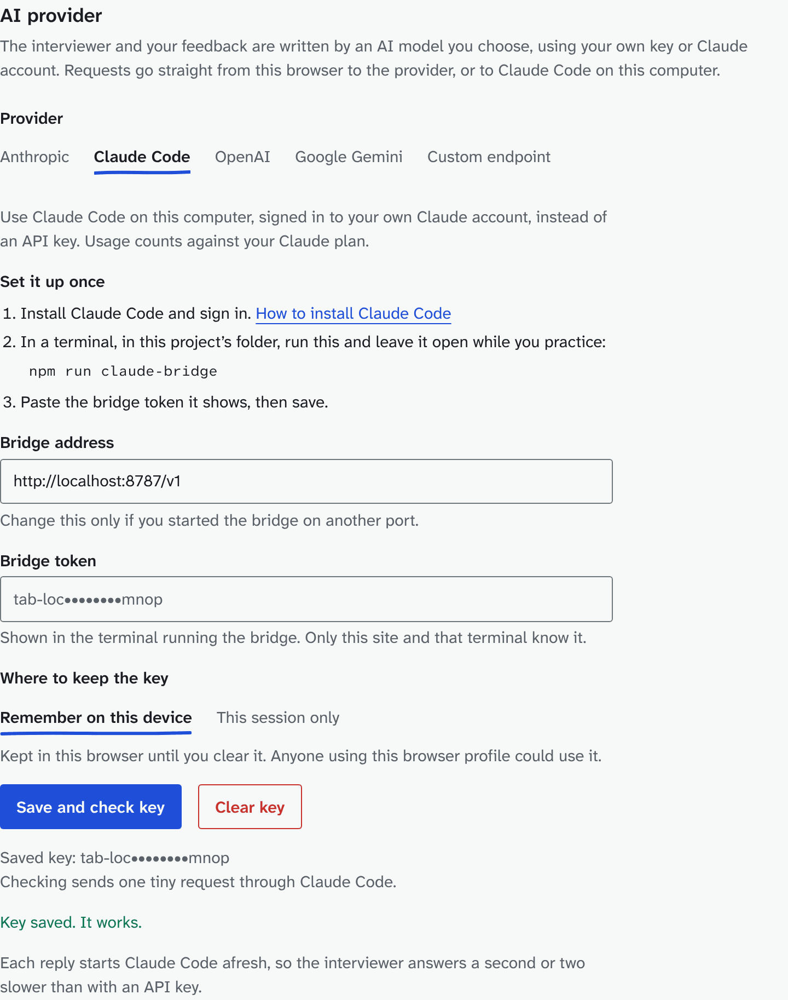

How the bridge stays safe and private:

- It listens on `127.0.0.1` only, needs the token on every request, and
  refuses web pages from sites other than this app's.
- Each request runs `claude -p` with no tools, no MCP servers, no hooks,
  no slash commands, no `CLAUDE.md` files and no saved session, in an empty
  temporary folder. Prompts and replies are never logged.
- The token is saved in `~/.config/think-aloud/bridge-token`.
  `npm run claude-bridge -- --new-token` replaces it, `--port` changes the
  port, and `--origin` allows another site.

Each reply starts Claude Code afresh, so the interviewer answers a second or
two slower than with an API key. The cost panel shows tokens instead of
dollars.

## What a session costs

You pay your AI provider directly. Estimates for a 45 minute interview in
Training mode (live feedback), with prices checked on 2026-11-11:

| Provider  | Economy | Balanced (default) | Best   |
|-----------|---------|--------------------|--------|
| Anthropic | $0.03   | $0.72              | $1.44  |
| OpenAI    | $0.03   | $1.15              | $3.37  |
| Gemini    | $0.13   | $0.33              | $0.56  |

- Realistic mode costs a little less. Preparing a pasted problem adds a
  one-time cost.
- Gemini's listed prices for its larger models double on 2026-12-01 and
  2027-01-01; the app switches automatically.
- Speech is free with the browser engine or on-device Whisper. Paid speech
  engines cost roughly $0.20 to $0.45 per 45 minute interview.
- Tokens aren't wasted: prompts are split so the stable part (rules, problem,
  analysis, earlier transcript) is cached, and only your newest turn costs
  full price.
- After three sessions, the estimate uses your own averages.

## Privacy

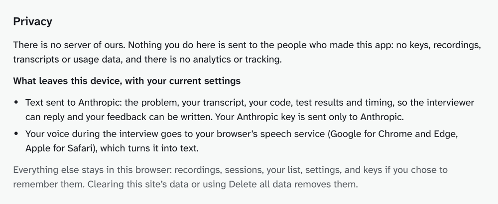

There is no server of ours. Nothing you do here is sent to the people who
made this app: no keys, recordings, transcripts or usage data. There is no
analytics or tracking, and fonts and runtimes are served from the app's own
origin.

What leaves your device:

- **Text to your AI provider** (the one you choose): the problem, your
  transcript, your code, test results and timing, so the interviewer can
  reply and your feedback can be written. Your key is sent only to that
  provider. (On Google's free tier, Google may use prompts to improve its
  products; on its paid tier it does not.) With Claude Code, the text goes
  to the bridge on your computer and from there to Anthropic.
- **Audio, depending on the speech engine you choose:**
  - Browser speech recognition (the default): your voice goes to your
    browser's speech service (Google for Chrome and Edge, Apple for
    Safari).
  - On-device Whisper: nowhere. The speech model is downloaded from Hugging
    Face the first time; none of your data is sent with that download.
  - A paid engine (Deepgram, AssemblyAI or OpenAI): your audio goes to the
    engine you chose, using your key.
  - Typing instead of speaking: no audio at all.

Everything else stays in your browser's storage: recordings, sessions, your
problem list, settings, and keys if you chose to remember them. **Settings →
Your data** exports everything (never keys), imports it, or deletes it. The
Settings screen shows this statement for your current choices.

## Browser support

- **Voice**: Chrome, Edge and Safari. In Firefox, or if the microphone is
  blocked, you type what you'd say instead.
- **Everything else** (editor, running code, replay): any current browser.
- **On-device Whisper** needs a recent computer. It uses WebGPU when
  available and WebAssembly otherwise.

## How it works

A fully static Vite + React + TypeScript + Tailwind site. No server code.

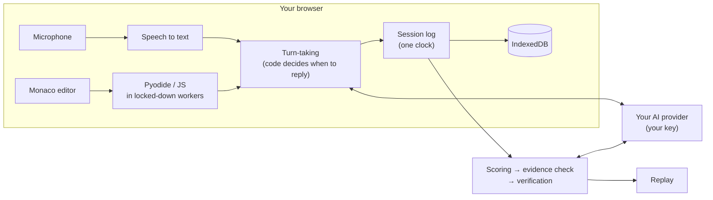

1. **Setup.** Built-in problems come with a precomputed analysis, so they
   need no analysis call. Pasted problems and variations are analyzed once
   with the strongest model in your preset and cached by their text.
2. **Interview.** Everything is stamped on one session clock: speech, code
   snapshots, test runs and the recording. Static code decides when to ask
   the model; the model decides what to say.
3. **Feedback.** Timing metrics are computed in code and passed to the model
   as inputs. Training shows reactions live, Delayed at each phase change,
   Realistic only in the replay.
4. **Replay.** A scoring call reads the transcript, code history, real test
   results and the analysis. Code checks every quote, a repair call fixes
   what it can, and an independent verification call removes or lowers
   anything the evidence doesn't support.

```
prompts/              every prompt, as readable Markdown
problems/             the built-in bank: one JSON file per problem
schema/               generated JSON Schema for problem files
scripts/              maintainer scripts, and the Claude Code bridge
src/config/           app name, CSP, models and prices, speech engines, usage model
src/copy/strings.ts   all interface text, in one place
src/lib/ai/           provider interface and adapters (Anthropic, OpenAI, Gemini, compatible)
src/lib/speech/       speech-to-text engines, turn-taking, alignment, Whisper
src/lib/runner/       sandboxed code runner (Pyodide and JS in Web Workers)
src/lib/interview/    the interviewer and the event log it reads
src/lib/feedback/     metrics, reactions, scoring, evidence checks, verification
src/lib/session/      the live interview controller and post-session processing
src/lib/replay/       timeline sync
src/ui/, src/screens/ components and screens
```

[DESIGN.md](DESIGN.md) explains the visual design: the marked-up transcript
concept, the palette, the typefaces (Atkinson Hyperlegible Next and Mono,
chosen so `l`, `I` and `1` never blur together), and a review of every
screen.

### Security

Keys live in the browser, so cross-site scripting is the main threat:

- A strict Content Security Policy in production (`src/config/csp.ts`):
  only the app's own scripts, and network access only to the supported AI
  and speech providers.
- Model output and pasted text are never rendered as HTML (a lint rule
  blocks it).
- Your code, and model-written reference solutions, run in Web Workers
  with network and storage access removed, and with a timeout.
- Dependencies are pinned to exact versions. Keys are never logged, never
  put in URLs, and are redacted from error messages.

If you use a custom OpenAI-compatible endpoint other than OpenRouter or
localhost, add its host to `CUSTOM_ENDPOINT_HOSTS` in `src/config/csp.ts`
and rebuild.

## Development

```bash
npm test                         # unit and integration tests
npm run lint && npm run typecheck
npm run problems:validate        # problem JSON schema
npm run problems:check-solutions # every reference solution, both languages
npm run build                    # static site in dist/
```

CI runs all of these on every pull request.

### Updating models and prices

Models and prices change. Each provider has one file:

- `src/config/providers/anthropic.ts`, `openai.ts`, `gemini.ts`: model ids,
  prices per million tokens (input, output, cache read, cache write),
  dated price changes, and the Economy, Balanced and Best presets.
- `src/config/speech.ts`: speech engine models and per-minute prices.
- `src/config/usageModel.ts`: the token-usage assumptions behind the cost
  estimate before you have history.

Each file notes the date its prices were checked and the pricing page.
`npm test` checks that presets stay ordered by cost.

### Deploying

`.github/workflows/deploy.yml` builds and publishes to GitHub Pages on every
push to `main` (enable Pages with "GitHub Actions" as the source). The build
is a plain static site in `dist/` that works on any static host. It uses
relative paths and hash routing, so no server configuration is needed.

## Known limits

- OpenAI live transcription needs a WebRTC session, and AssemblyAI live
  transcription needs a server-issued token, so those two engines are used
  after the interview only. Deepgram works live.
- With Claude Code, every call starts a new `claude` process, which adds
  about 1.5 seconds before the interviewer starts to answer.
- The replay's audio is your microphone; the interviewer's lines appear as
  text in the transcript but aren't in the recording.
- The built-in bank's analyses were written by the maintainers. Run
  `npm run problems:analyze -- --all --force` with your own key to
  regenerate them with the strongest model.

## Contributing

Problems, prompts, providers and speech engines are all designed to be
added. [CONTRIBUTING.md](CONTRIBUTING.md) covers each one. The one hard rule
for problems: write them yourself. This repository never contains text from
LeetCode or any other site.

The app name is a working name. It lives in one place, `src/config/app.ts`.

## License

MIT. See [LICENSE](LICENSE).
